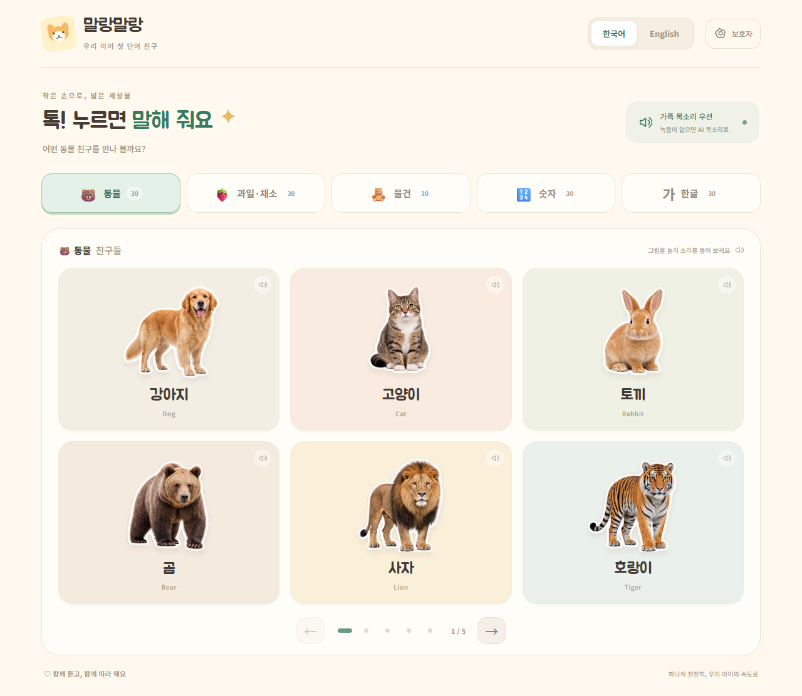

# 말랑말랑 단어놀이

약 24개월 아이와 보호자가 함께 사용하는 한국어·영어 단어놀이 앱입니다. 갤럭시 탭과 안드로이드 휴대폰에 설치할 수 있고, 웹에서도 사용할 수 있습니다.

## 다운로드

- **[안드로이드 APK 다운로드](https://github.com/qunix86b-ctrl/malang-word-play/releases/latest/download/malang-word-play.apk)**
- **[브라우저에서 바로 사용](https://qunix86b-ctrl.github.io/malang-word-play/)**
- [전체 릴리스와 설치 파일](https://github.com/qunix86b-ctrl/malang-word-play/releases)

APK를 내려받아 열고 설치하세요. Android에서 묻는 경우 다운로드에 사용한 브라우저 또는 파일 앱의 ‘이 출처 허용’을 켜 주세요. 회사·학교 관리 기기에서는 설치가 제한될 수 있습니다. 지원 범위는 Android 7 이상이며 최신 Android System WebView를 권장합니다.

웹에서는 갤럭시 Chrome 메뉴의 **앱 설치 / 홈 화면에 추가**를 사용할 수 있습니다. 웹 앱은 첫 실행과 오프라인 파일 저장이 끝날 때까지 인터넷이 필요합니다. APK는 처음부터 이미지와 음성을 포함합니다.



## 담긴 기능

| 종류 | 항목 수 | 구성 |
|---|---:|---|
| 동물 | 30 | 강아지, 고양이, 토끼, 코끼리, 기린 등 |
| 과일·채소 | 30 | 사과, 바나나, 딸기, 당근, 브로콜리 등 |
| 물건 | 30 | 공, 자동차, 책, 신발, 칫솔 등 |
| 숫자 | 30 | 1–30, 한국어 한자어 수 읽기(일·이·삼)와 영어 |
| 한글 | 30 | 가–하, 거–허, 고·노 음절 |

- 사진처럼 사실적인 **AI 생성 누끼 스티커 90개**. 숫자와 한글은 큰 글자 스티커로 표시합니다. 실물 촬영 사진은 아닙니다.
- 한 페이지에 큰 버튼 6개, 탭마다 5페이지. 태블릿 3열, 휴대폰 2열.
- 한국어·영어 **신경망 합성 음성 270개**를 기본 제공. 한글은 영어 모드에서도 정확한 한국어 발음으로 읽습니다.
- 가족 목소리 / 아이 목소리, 한국어 / 영어를 단어별로 독립 저장합니다. 선택한 녹음이 없으면 기본 AI 음성을 재생합니다.
- 최대 10초 녹음, 미리 듣기, 명시적으로 저장하기, 개별 삭제.
- AI 음성 속도와 단어 표시 설정, 보호자 확인 문제, 녹음 파일 내보내기·가져오기.
- 로그인, 광고, 분석 SDK, 사용자 음성 업로드 없음.

## 녹음 방법

1. 우측 상단 **보호자** → 덧셈 정답 입력.
2. **우리 목소리 녹음하기** → 목소리·언어·종류·단어 선택.
3. 마이크 권한 허용 → **녹음 시작** → **녹음 끝내기**.
4. **방금 녹음 듣기**로 확인하고 **이 목소리 저장**을 누릅니다.
5. 설정에서 **가족 목소리** 또는 **아이 목소리**를 선택합니다.

녹음은 기기의 앱/브라우저 저장소(IndexedDB)에 보관됩니다. 다른 기기나 APK와 웹 사이에 자동 동기화되지 않습니다. 앱 삭제, 웹사이트 데이터 삭제 시 사라질 수 있으므로 **녹음 내보내기**로 보관하세요. 가져오기는 같은 단어·언어·목소리 슬롯을 덮어쓰기 전에 확인을 받습니다. Android 내보내기는 시스템 파일 저장 창을 사용합니다.

## 개발 및 확인

Node.js 22 이상:

```sh
npm ci
npm run dev
npm test
npm run build
npm run test:e2e
npm run android:sync
```

브라우저 테스트는 Chrome과 가상 마이크를 사용합니다. `npm test`는 항목 수, 한글 읽기 규칙, 음성 파일, 이미지 알파 채널을 검증합니다. 브라우저 테스트는 화면 크기, 모든 페이지, 음성 재생, 녹음 저장·언어 분리·삭제, 마이크 정리, 오프라인 재실행을 검증합니다.

Android 빌드: Java 21, Android SDK 36, Build Tools 36이 필요합니다. `android/`를 Android Studio에서 열거나 `android/gradlew -p android assembleDebug`로 테스트 APK를 만듭니다. 배포 서명 키는 저장소에 포함되지 않습니다. 로컬 `.tools/malang-release.jks`와 `.tools/signing.properties`는 향후 업데이트를 위해 **비공개로 백업**해야 합니다. 다른 키로 서명한 APK는 기존 앱을 업데이트할 수 없습니다.

`scripts/setup-android.py`는 Windows용 도구를 프로젝트 내부에 설치합니다. SDK 라이선스는 별도로 동의해야 합니다. `scripts/create-signing-key.py`는 최초 한 번만 배포 키를 만듭니다.

## 음성과 이미지

- 기본 음성: Microsoft `ko-KR-SunHiNeural`, `en-US-JennyNeural`. `edge-tts` 7.3.1을 통해 고정 단어만 생성했습니다. 앱 실행 중 이 서비스로 사용자 데이터를 전송하지 않습니다. 서비스 변경에 따라 음성 재생성 도구가 동작하지 않을 수 있으며, 번들 음성 재생에는 영향이 없습니다.
- 음성 재생성: Python 환경에 `edge-tts==7.3.1` 설치 → `node scripts/export-words.mjs` → `python scripts/generate-audio.py`.
- 사진 스타일 스티커: 내장 이미지 생성 도구. 원본, 사용한 프롬프트는 `public/stickers/`, `docs/image-prompts.json`에 보관합니다.
- 글꼴: Jua, Noto Sans KR (SIL Open Font License). 글꼴도 앱에 포함하여 오프라인에서 표시합니다.

자세한 개인정보 처리 내용은 [PRIVACY.md](PRIVACY.md), 검증 범위는 [docs/VALIDATION.md](docs/VALIDATION.md)를 확인하세요.
